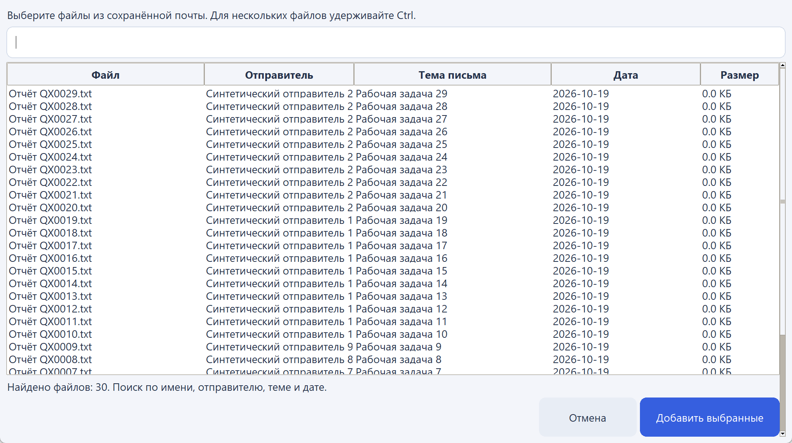

# Mail Agent — локальный почтовый ассистент

Персональное desktop-приложение для Windows: разбор Gmail, каталог почтовых
вложений с локальным OCR, подготовка писем по текстовым и голосовым запросам.
Версия **0.12.0-beta.2**. Отправку пользователь подтверждает отдельно.



## Возможности

- Gmail OAuth: обработка новых и старых писем, девять фиксированных категорий,
  карантин без удаления оригинала, пропуск обработанных писем, прогресс и остановка.
- Сохранение вложений с источником письма. Выбор файлов из плоского списка
  с исходными названиями, отправителем, темой, датой и поиском; служебные папки
  и SQLite-файлы пользователю не предлагаются. Повторное добавление сохраняет
  уже выбранные вложения. Отправляемый файл получает исходное имя из метаданных.
- Каталог SQLite: извлечение текста из TXT/CSV/MD/LOG/DOCX/PDF, OCR изображений
  и сканированных страниц, поиск по словам, предпросмотр и переход к письму.
- Контакты, псевдонимы и явное обращение. При неизвестном или неоднозначном
  получателе приложение требует уточнение. Чужие имена из приветствий истории
  не используются для нового обращения; пустое поле обращения даёт «Здравствуйте!».
- Локальная LLM готовит редактируемые тему и текст, поисковые запросы вложений;
  при необходимости использует ограниченные образцы стиля отправленных писем.
- Диктовка через локальный Whisper. Успешная новая диктовка начинает отдельный
  запрос. Текст можно исправить до подготовки письма.
- Подтверждение отправки с проверкой адреса, существования файлов и размера.

## Стек и поток данных

Python 3.12, Tkinter/ttk, Gmail API и google-auth-oauthlib, LM Studio
(OpenAI-compatible chat completions), SQLite/WAL, pypdf, PDFium, Pillow,
faster-whisper/CTranslate2, sounddevice и NumPy.

Сортировка: Gmail → список ID → заголовки/текст → локальная LLM → проверка
категории → сохранение допустимых вложений → метки Gmail.

Письмо: запрос/диктовка → разрешение адресата → LLM → валидация JSON →
поиск файлов → редактирование → подтверждение → MIME-письмо через Gmail API.

Поиск буквальный, без embeddings и векторной базы. Модели не обучались в проекте.
LLM/OCR/ASR работают локально; подключение к Gmail требует интернета.
Фоновые задачи передают изменения интерфейсу через очередь; поиск в SQLite
доступен во время сканирования благодаря WAL.

## Запуск

```powershell
python -m venv .venv
.\.venv\Scripts\python.exe -m pip install -r requirements.txt
.\.venv\Scripts\python.exe app.py
```

После установки доступен запуск через `start.cmd`. Установщик пока не подготовлен.

1. В Google Cloud включите Gmail API и создайте OAuth-клиент Desktop app.
2. Поместите клиентский JSON в `private/credentials.json`. Для OAuth в режиме
   Testing добавьте свой аккаунт в тестовых пользователей.
3. Запустите локальный сервер LM Studio. По умолчанию:
   `http://127.0.0.1:22227/v1`, идентификатор `qwen3.5-4b`.
   Для OCR требуется модель с поддержкой изображений.
4. В разделе «Почта» подключите Gmail. Папка вложений настраивается отдельно.
5. Перед поиском по содержимому выполните сканирование в разделе «Вложения».

Для диктовки выберите локальную папку faster-whisper с `model.bin`, `config.json`
и `tokenizer.json`. Предпочтение отдаётся `private/speech-model-small`, затем
локальному кешу tiny. Приложение самостоятельно модели не скачивает.
Whisper запускается на CPU, INT8, двумя потоками; запись ограничена 120 секундами.

## Проверки и измеренные результаты

Полная методика, критерии, исходные ограничения и результаты:
[BENCHMARK_RESULTS.md](BENCHMARK_RESULTS.md).

Прогон 19 октября 2026 года:

| Проверка | Результат |
|---|---:|
| Классификация 90 синтетических писем через реальный Gmail | 90/90 после уточнения правила; первоначально 88/90 |
| PDF/изображения: номер, сумма и месяц | 30/30 |
| Черновики: адресат, приветствие, факт, вложение | 30/30 |
| Контакты, каталог и список файлов | 30/30 сценариев |
| Граничные случаи | 30/30 |
| Реальная отправка самому себе и проверка входящей копии/хеша вложения | 30/30 |
| Речь: точное совпадение на синтетическом TTS | 26/30; WER 5,30% |

Обычные и интеграционные unittest-проверки описаны в [TESTING.md](TESTING.md).
История тестирования фиксирует также найденные ошибки и предыдущие версии.

```powershell
.\.venv\Scripts\python.exe -m unittest discover -v
$env:MAIL_AGENT_LIVE_TESTS = '1'
.\.venv\Scripts\python.exe -m unittest discover -v
```

Интеграционные тесты требуют LM Studio и локального Whisper. В CI они пропускаются.
Для генерации документов, coverage и аудита установите `requirements-dev.txt`.

`functional_benchmark.py --phase all --directory private/your-run` создаёт
документы, импортирует 90 синтетических входящих и **отправляет 30 писем самому
себе** через подключённый Gmail. Фазы можно запускать отдельно. Результаты
сохраняются по каждому случаю; неопределённые отправки автоматически не повторяются.
`gmail_autotest.py` без `--gmail` только экспортирует 18 EML-файлов.

## Ограничения

- Проверки синтетические. После уточнения правила классификации повторён тот же
  набор; это не независимый корпус для оценки обобщения модели.
- WER получен на Windows TTS Microsoft Irina, не на реальном микрофоне.
  В четырёх фразах остались ошибки; диктовку нужно проверять.
- OCR-успех означает совпадение проверяемых полей, не полную точность всех символов.
  Рукописи, сложные таблицы и плохие фотографии отдельно не оценены.
- Проверка доставки выполнена внутри одного Gmail-аккаунта. Другие провайдеры
  и внешняя почтовая доставка не проверялись этим прогоном.
- Файл для индексирования — до 20 МБ, PDF — первые 20 страниц, изображение —
  до 25 млн пикселей, индекс — до 200000 символов. Многостраничный TIFF не поддержан.
- Исходящее MIME-письмо — до 25 МБ, суммарные вложения — до 18 МБ.
- Категории фиксированы; обычная классификация назначает метки, а не переносит
  письма в физические папки. Карантин убирает из входящих без удаления.
- Отправленные, черновики, корзина и Gmail-спам исключены из обычного разбора.
- Журнал хранится до закрытия окна. Расписание, несколько аккаунтов, другие
  провайдеры, семантический поиск и отмена сортировки пока не реализованы.

## Приватные данные

OAuth-токен, контакты, письма, модели, аудио и подробные результаты хранятся
локально и исключены из Git. Сам токен сохраняется в JSON, без собственного
шифрования; хранение в системном хранилище секретов пока не реализовано.
Не публикуйте `private/`, `.env`, `.venv`, базы SQLite и клиентские credentials.
Для обращений к LLM разрешены loopback HTTP-адреса, прокси и редиректы отключены.
Это ограничения приложения, а не заявление об абсолютной защите от всех атак.
